<div align="center">

# pycode-skills

**Skills para o seu agente de IA criar aulas interativas, páginas, carrosséis e designs do jeito que a gente faz na PycodeBR.**

[](LICENSE)
[](https://github.com/pycodebr/pycode-skills/actions/workflows/ci.yml)
[](skills)
[](#instalação)
[](#instalação)
[](#instalação)
[](#instalação)
[](#instalação)
[](#instalação)

Feito pela [PycodeBR](https://github.com/pycodebr) · Felipe Azambuja · [English below](#english)

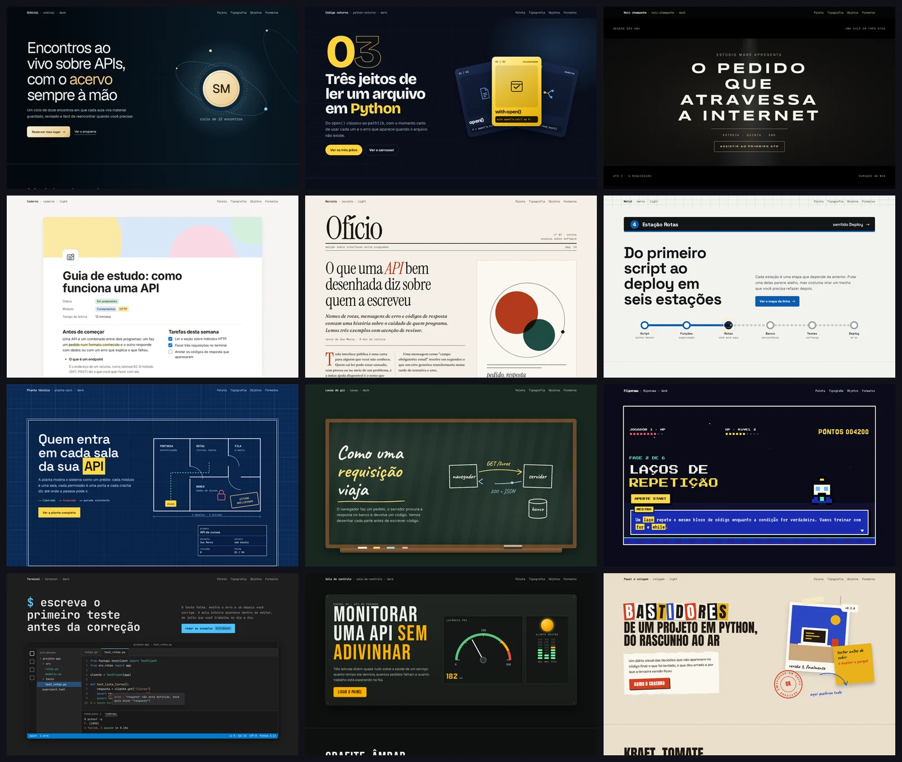

</div>

## O que é

Este repositório reúne skills no padrão aberto `SKILL.md` (Agent Skills). Você instala uma vez e o seu agente passa a saber fazer, do começo ao fim, alguns dos artefatos que produzimos na PycodeBR: ele planeja, constrói, testa no navegador, revisa as capturas e só então entrega.

| Skill | O que o agente passa a fazer |
|---|---|
| [`pycode-aulas`](skills/pycode-aulas) | Aulas e apresentações em HTML que avançam cena a cena, como um PowerPoint animado, mais o material de estudo para o Notion e desenhos opcionais no Whimsical |
| [`pycode-paginas`](skills/pycode-paginas) | Landing pages e sites estáticos com um objeto visual para cada assunto, CSS crítico, fontes locais e medição de performance |
| [`pycode-carrosseis`](skills/pycode-carrosseis) | Carrosséis de Instagram em 4:5 com conceito visual por post, texto renderizado por código e slides em vídeo curto |
| [`pycode-design`](skills/pycode-design) | Os 12 estilos de design usados pelas outras três, com tokens, guia de cada estilo e galerias de referência para estudo |

Tudo o que as skills geram é HTML, CSS e JavaScript comuns, sem framework. Os arquivos ficam na sua máquina e você publica onde quiser.

## Instalação

**Pelo agente.** Cole esta frase no seu agente de IA:

```text
Instale as skills deste repositório seguindo o AGENTS.md dele: https://github.com/pycodebr/pycode-skills
```

**Pelo terminal.** Um comando, sem `sudo`:

```bash
curl -fsSL https://raw.githubusercontent.com/pycodebr/pycode-skills/main/install.sh | bash
```

O instalador encontra os agentes que você tem (Claude Code, Codex, OpenCode, Cursor, Gemini CLI e Hermes), liga as quatro skills em cada um e instala todas as dependências dentro de `~/.pycode-skills`: ambiente Python, Chromium, Node com Lighthouse, csso e Mermaid CLI, ffmpeg, as fontes e o GSAP. No fim ele roda `pycode doctor` e mostra o que ficou pronto. Depois disso, reinicie a sessão do agente para ele ler as skills novas.

- Funciona em macOS e Linux. No Windows, use o WSL.
- Precisa de `curl` e de cerca de 2,5 GB livres. A primeira instalação leva de 5 a 10 minutos, quase tudo por causa do Chromium.
- Para escolher os agentes: `bash install.sh --agent claude,codex` (ou `all`). Para outros agentes compatíveis com Agent Skills: `npx skills add pycodebr/pycode-skills -g`, e depois `bash ~/.pycode-skills/src/scripts/setup.sh` para as dependências.

## Como pedir

Depois de instalar, peça em português normal. Alguns exemplos:

```text
Crie a apresentação da minha aula sobre filas e mensageria, com 10 cenas, no estilo planta-azul.
Monte a landing page da minha oficina de Django no estilo revista e me mostre os números do Lighthouse.
Faça um carrossel de 7 slides explicando como funciona o cache, no conceito do mapa do metrô.
Quero um estilo novo baseado nesta página de referência: https://exemplo.com
Gere o material de estudo desta aula para eu publicar no Notion.
```

Antes do primeiro pedido, vale preencher a sua marca em `~/.pycode-skills/brand.json` (nome, @, site, estilo padrão e cores). O agente usa esses dados em tudo o que criar.

## As skills

### pycode-aulas

Cada cena da aula tem um desenho próprio que explica o assunto: um pedido viajando por um circuito, um terminal digitando, um mapa em que os dados andam. Ao entrar na cena, a demonstração toca uma vez; quando você clica, ela para e o controle passa para você. A apresentação funciona com teclado, toque, tela cheia, índice de cenas e cronômetro, tem modo leitura para quem estuda depois e se reorganiza no celular. O agente ainda exporta PDF e PPTX e escreve o material de estudo para o Notion.

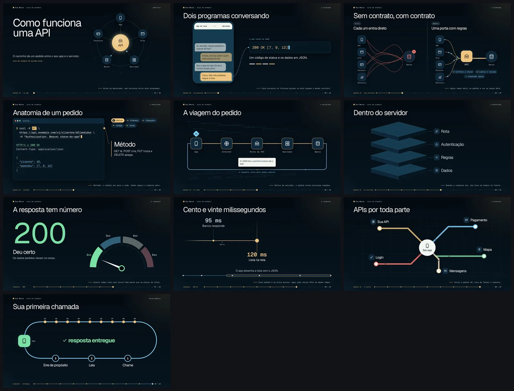

| | |
|---|---|
| 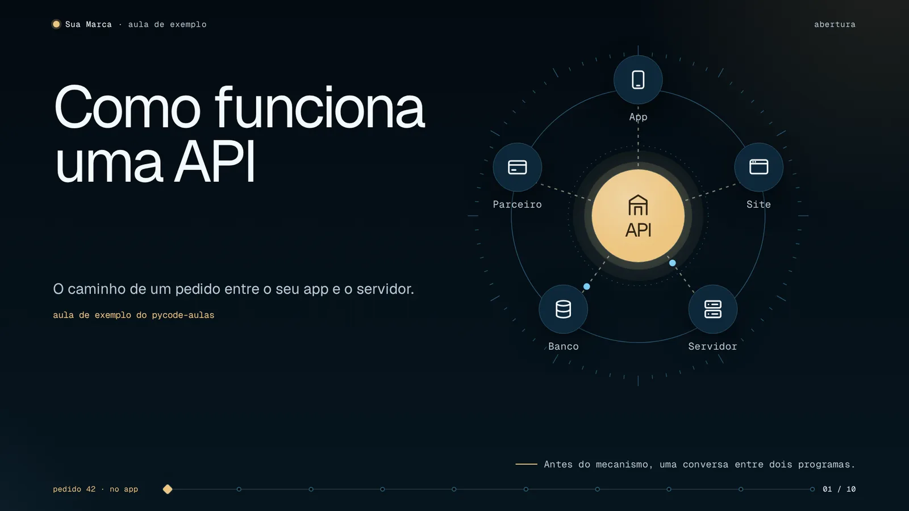 | 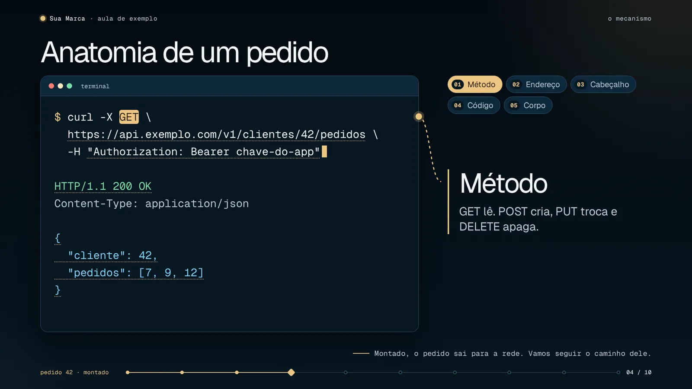 |
| 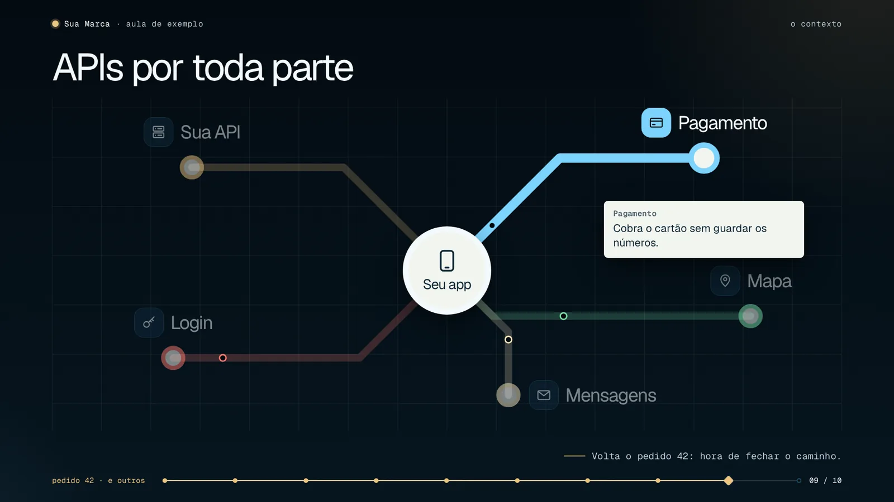 |  |

### pycode-paginas

A página de exemplo não usa grade de cartões iguais: o programa do curso é uma folha de caderno, a duração é uma régua, a inscrição é um ingresso com canhoto. Por baixo, o build incorpora o CSS crítico, carrega o restante sem bloquear a primeira pintura, usa fontes locais e põe hash no nome dos arquivos. O QA abre a página em quatro larguras, testa cada âncora pela posição medida, confere a leitura sem JavaScript e o movimento reduzido, e o comando de performance roda o Lighthouse várias vezes e informa a mediana.

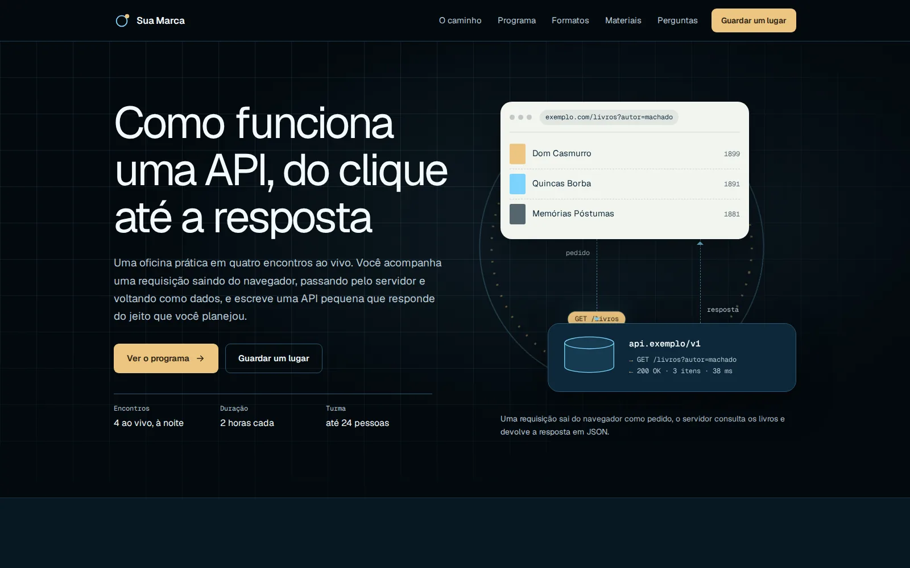

| | |
|---|---|
| 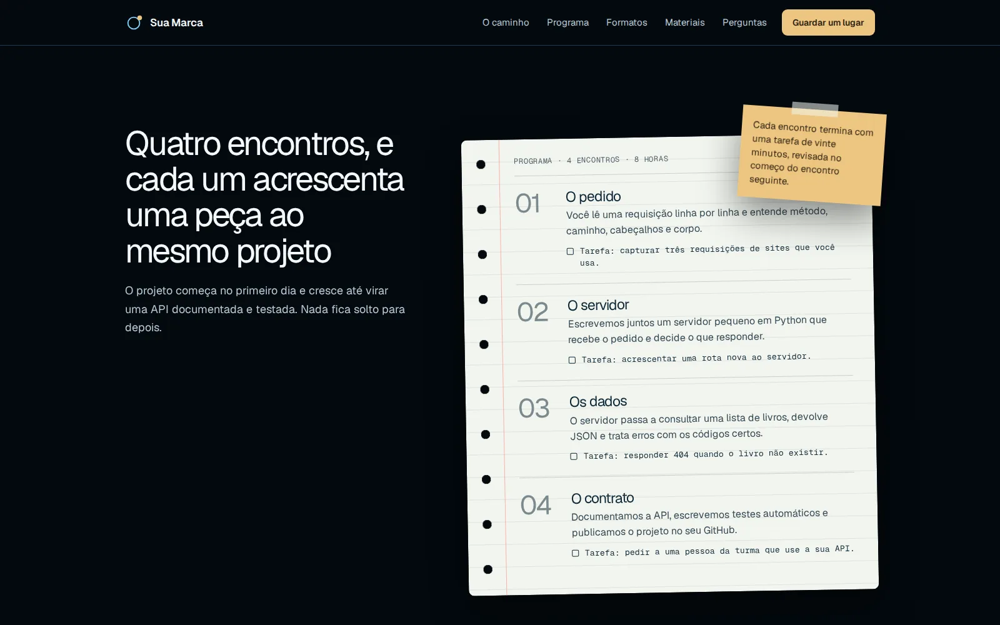 |  |
| 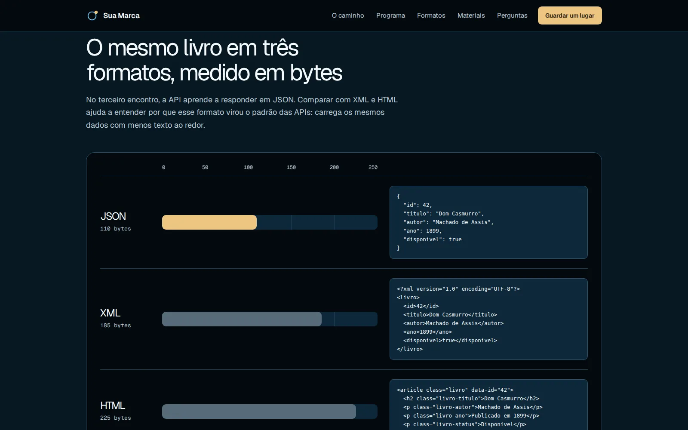 | 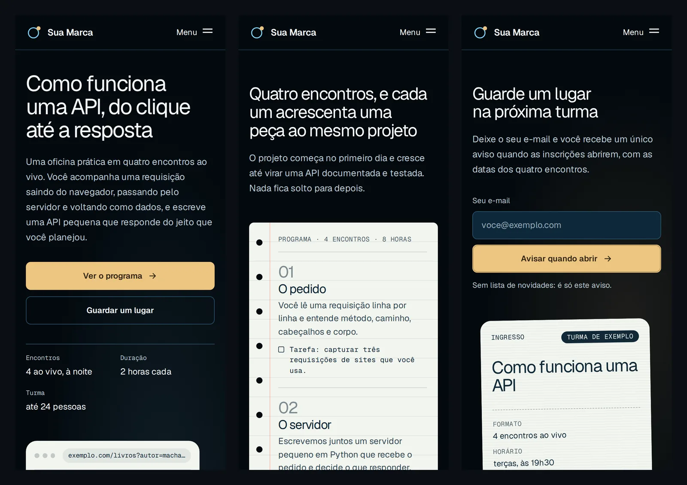 |

### pycode-carrosseis

Cada carrossel nasce de um conceito visual que atravessa todos os slides: cartas colecionáveis, uma linha de metrô, uma escada de níveis, um fliperama. O texto é sempre renderizado por código, então comando e código saem exatos e o exemplo que aparece no slide foi executado. O agente confere contraste, margens, quantidade de texto e pedido de ação único, grava a capa em vídeo e monta uma prévia que simula o post no celular. Funciona sem gerador de imagens; se o seu agente tiver um, a skill ensina a usar cenas geradas como fundo e a manter o texto por código.

| | |
|---|---|
| 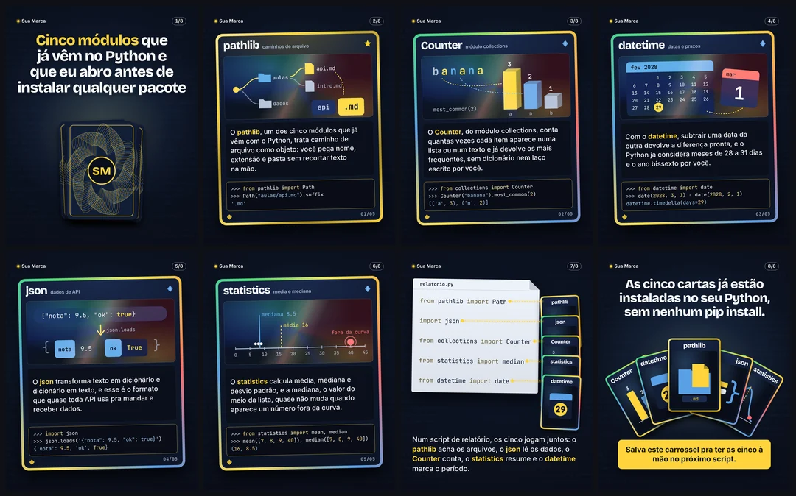 | 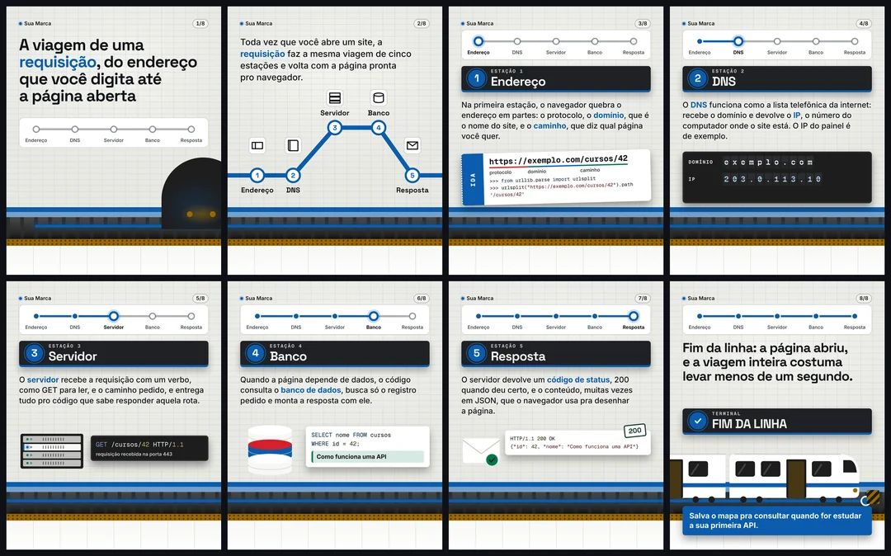 |
|  | 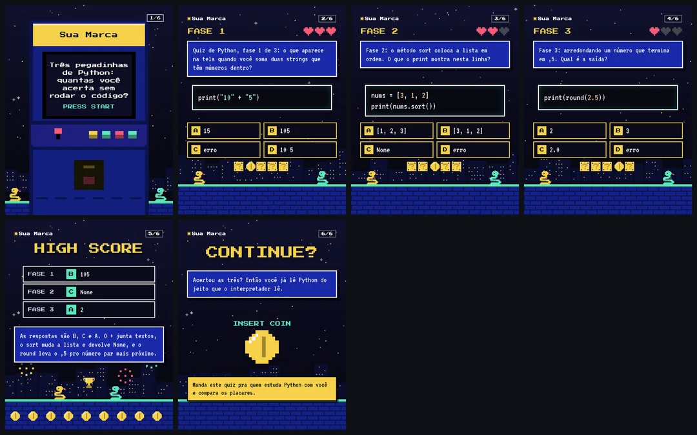 |

### pycode-design

Os estilos são a base das outras três skills. Cada um traz os tokens (cores, tipografia, raios e sombras num contrato comum), um `DESIGN.md` com os objetos e o movimento que dão identidade ao estilo, e uma prévia. Como os modelos de aula, página e carrossel só usam os tokens do contrato, qualquer estilo serve para qualquer artefato, e você pode criar o seu com `pycode styles new`.

| Estilo | Clima | | Estilo | Clima |
|---|---|---|---|---|
| `orbital` | marinho, dourado e luz ciano | | `revista` | editorial claro com serifa |
| `python-noturno` | azul-marinho com azul e amarelo | | `caderno` | documento claro para estudo |
| `noir-champanhe` | preto e champanhe, trailer de cinema | | `metro` | sinalização e mapa de linhas |
| `planta-azul` | planta técnica | | `colagem` | papel e recortes |
| `lousa` | giz sobre quadro | | `terminal` | editor e linha de comando |
| `fliperama` | pixel art | | `sala-de-controle` | painel de instrumentos |

| | |
|---|---|
|  |  |
| 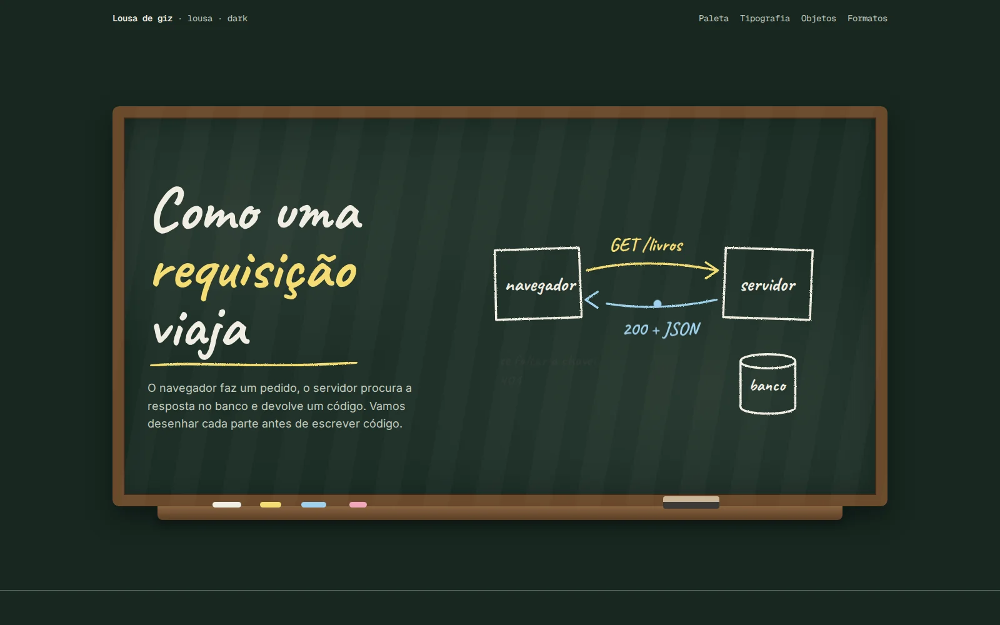 | 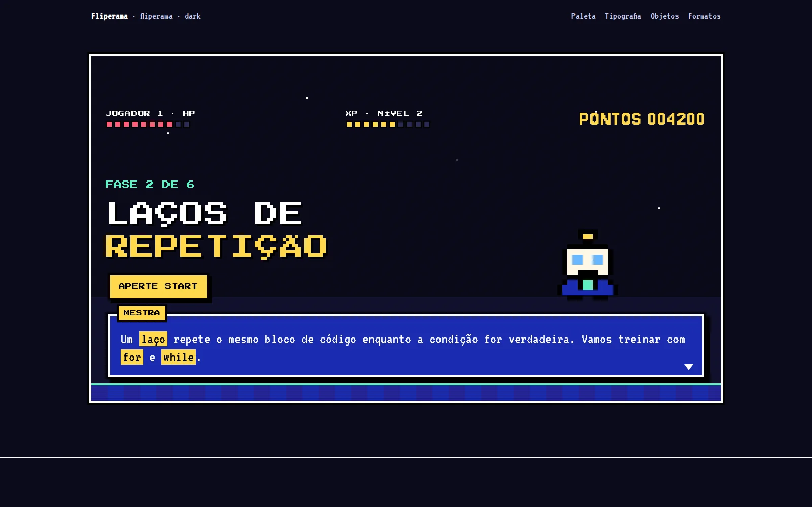 |

A skill também cataloga galerias públicas de referência. `pycode refs fetch` baixa esses acervos só para a sua máquina, para estudar composição e movimento; eles não fazem parte deste repositório, e os que não têm licença declarada não devem ser copiados nem redistribuídos.

## O comando pycode

O agente usa um comando único, e você também pode usar:

| Comando | Para quê |
|---|---|
| `pycode doctor` | conferir a instalação |
| `pycode help` | listar todos os comandos |
| `pycode styles list` · `pycode styles preview` | ver os estilos e gerar a galeria |
| `pycode deck new` · `build` · `qa` · `export` · `notion` | criar, montar, testar e exportar uma aula |
| `pycode page new` · `build` · `qa` · `perf` | criar, montar, testar e medir uma página |
| `pycode carousel new` · `render` · `video` · `qa` · `preview` | criar, renderizar e conferir um carrossel |
| `pycode serve <pasta>` | abrir uma prévia local |
| `pycode update` | atualizar as skills e as dependências |

Para remover tudo: `bash ~/.pycode-skills/src/install.sh --uninstall`. Os projetos que você criou continuam nas pastas deles.

## Perguntas comuns

**Preciso de um gerador de imagens?** Não. Aulas, páginas e carrosséis são desenhados por código. Com um gerador, a skill de carrosséis mostra como usar cenas geradas sem deixar o texto por conta do modelo de imagem.

**Preciso de conta em algum serviço?** Não para criar. O Notion e o Whimsical são opcionais: sem conexão, o agente entrega o material em Markdown e os diagramas em SVG.

**As páginas dependem de CDN?** Não. Fontes e bibliotecas ficam dentro de cada projeto, e o build reprova URL externa em tempo de execução.

**Posso usar em projeto comercial?** Sim. O código é MIT. Fontes, GSAP e ícones têm licença própria, descrita em [THIRD_PARTY.md](THIRD_PARTY.md).

**Algo falhou na instalação.** Rode `pycode doctor`: ele mostra o que falta e o comando que corrige. Se não resolver, abra uma issue com essa saída.

## Para agentes de IA

As instruções de instalação, conferência e uso para agentes estão em [AGENTS.md](AGENTS.md). O resumo: rode o `install.sh`, confirme com `pycode doctor`, leia o `SKILL.md` da skill antes de produzir e use sempre o comando `pycode`.

## Contribuindo

Este repositório vai receber mais skills, estilos e macetes do que a gente usa no dia a dia. Sugestões e correções são bem-vindas: veja [CONTRIBUTING.md](CONTRIBUTING.md). As versões ficam registradas no [CHANGELOG.md](CHANGELOG.md).

## Licença

[MIT](LICENSE) · PycodeBR (Felipe Azambuja). Componentes de terceiros são baixados na instalação e mantêm as próprias licenças: [THIRD_PARTY.md](THIRD_PARTY.md).

---

## English

**pycode-skills** is a set of [Agent Skills](https://agentskills.io) (`SKILL.md`) by PycodeBR that teach your AI agent to build, test and deliver four kinds of artifacts: interactive lesson decks in HTML (`pycode-aulas`), fast static landing pages and sites (`pycode-paginas`), Instagram carousels with code-rendered text and short MP4 slides (`pycode-carrosseis`), and a library of 12 design styles with tokens and guides (`pycode-design`). The skills and their documentation are written in Brazilian Portuguese.

```bash
curl -fsSL https://raw.githubusercontent.com/pycodebr/pycode-skills/main/install.sh | bash
```

The installer links the skills into Claude Code, Codex, OpenCode, Cursor, Gemini CLI and Hermes, and installs every dependency under `~/.pycode-skills` without `sudo` (Python environment, Playwright Chromium, Node tools, ffmpeg, OFL fonts and GSAP). macOS and Linux; use WSL on Windows. MIT licensed.
